# Keep Wallet

**A personal expense tracker for Android that keeps everything on your phone.**
No account, no cloud, no ads, no analytics. Built with Kotlin, Jetpack Compose and Material 3.

<p align="center">
  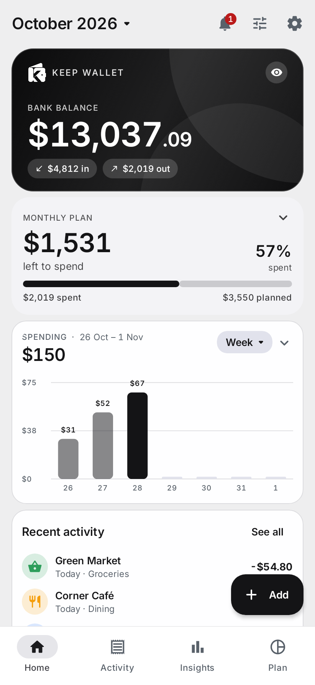
  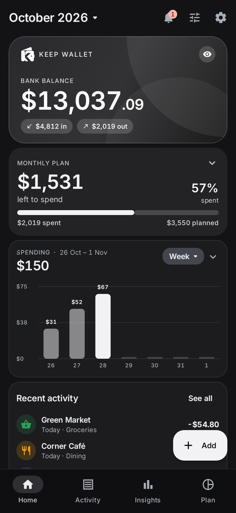
  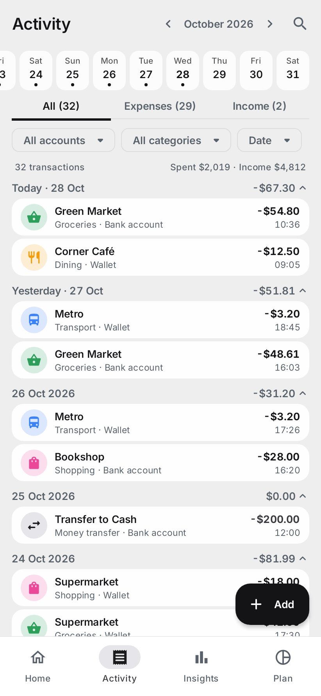
  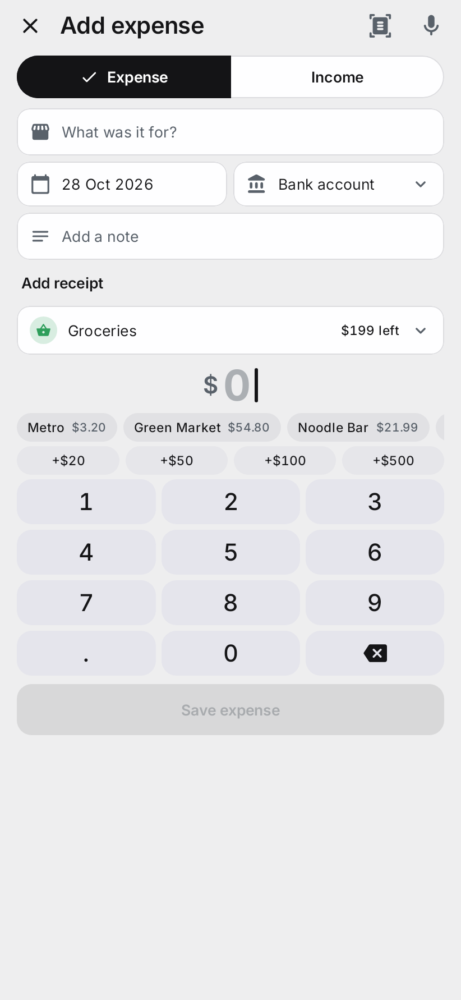
</p>

<p align="center">
  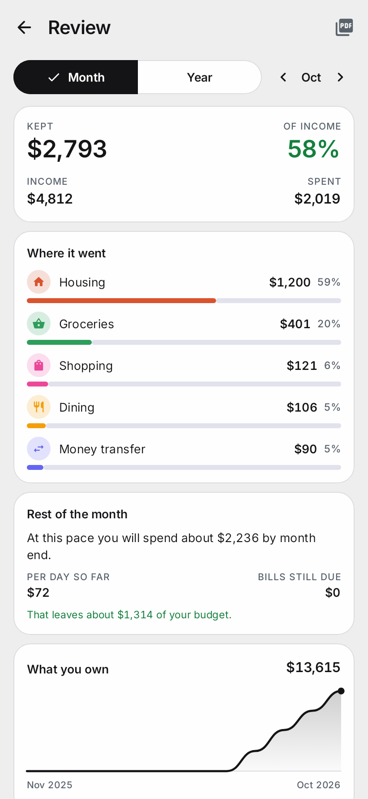
  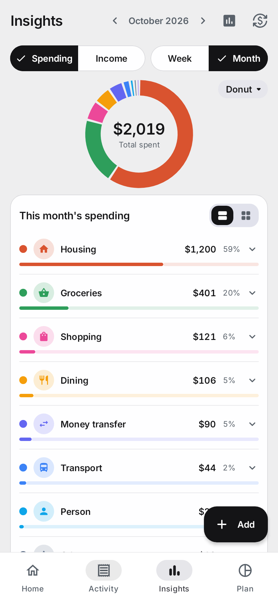
  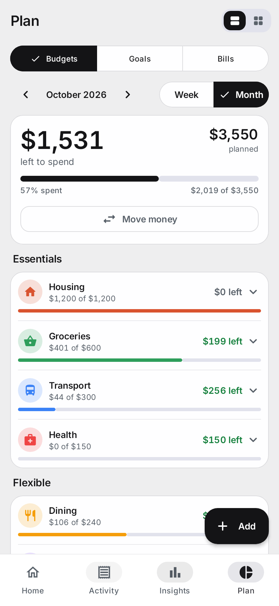
  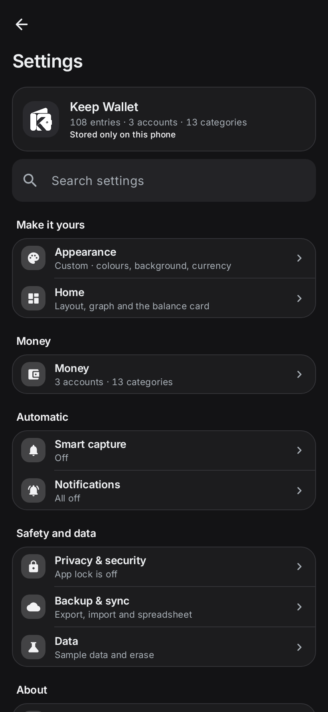
</p>

<p align="center">
  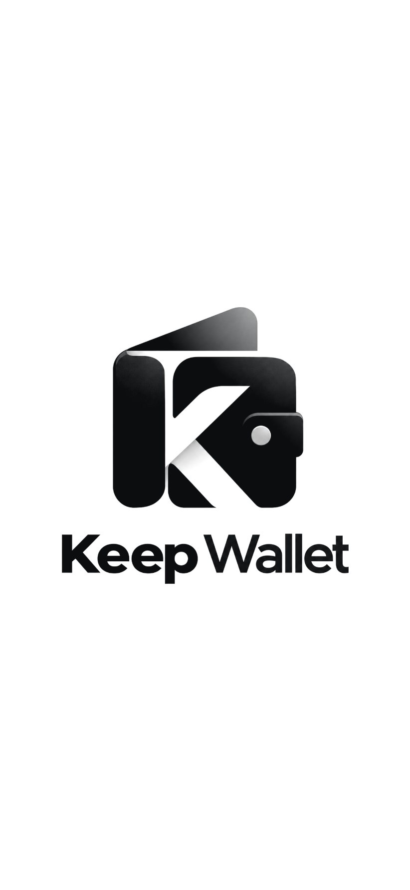
  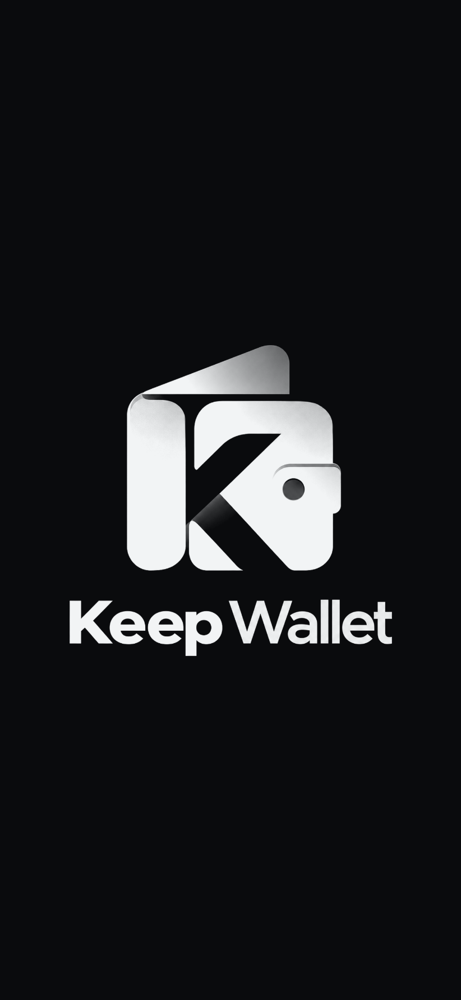
  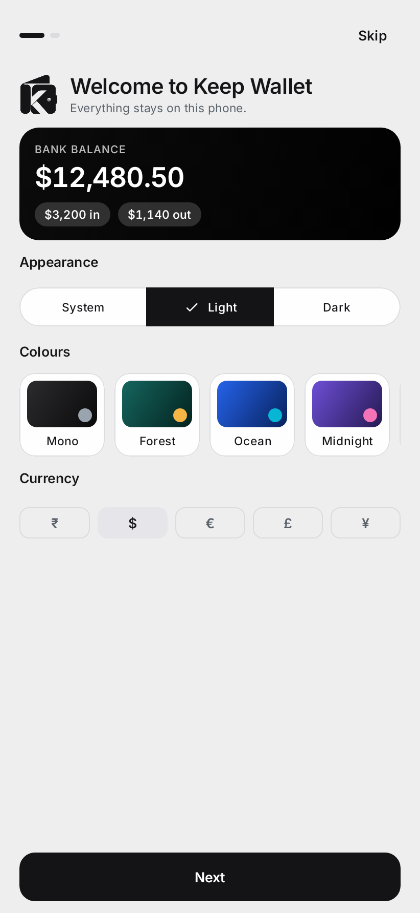
  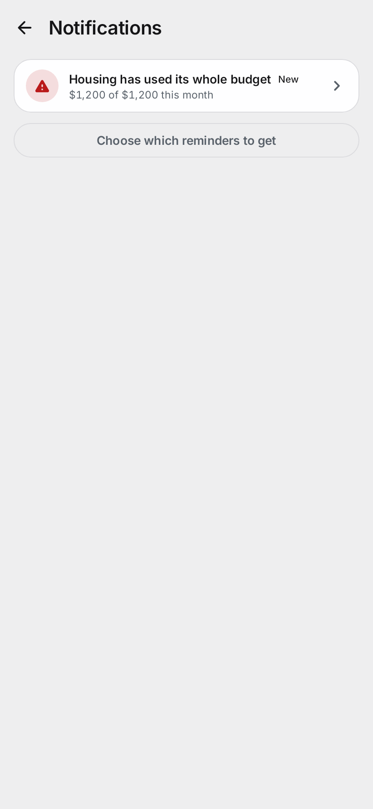
</p>

<p align="center">
  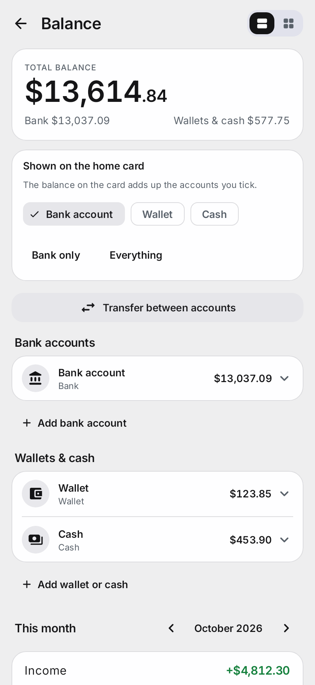
  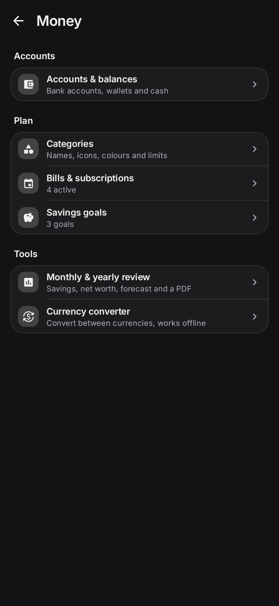
  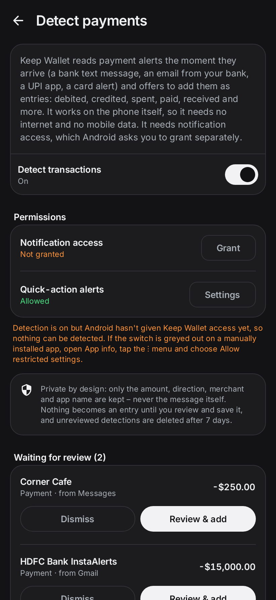
</p>

> The screenshots are rendered by the test suite with demo data (`ReadmeScreenshotTest`), in the default black-and-white look.

---

## Contents

- [Features](#features)
- [Privacy and permissions](#privacy-and-permissions)
- [Getting started](#getting-started)
- [Building](#building)
- [Testing](#testing)
- [Project layout](#project-layout)
- [How it works](#how-it-works)
- [Design notes](#design-notes)
- [Backup format](#backup-format)
- [Third-party software](#third-party-software)
- [Roadmap](#roadmap)
- [License](#license)

## Features

### Everyday tracking
- **Add in seconds, on one screen**: what it was for and when at the top, receipt and split as plain links, a category picker, then the amount with a keypad at the bottom, all without scrolling. Quick amounts, quick-fill from the things you repeat, the budget left in a category while you type, a duplicate-entry warning, and a split across categories. Health is among the ready-made categories.
- **Several accounts**: bank, wallet and cash, with balances and **transfers** between them (two linked entries, counted once).
- **Receipt scanning**: read the total, shop and date from a photo, entirely on the phone (Google ML Kit, bundled model). The photo stays attached to the entry.
- **Voice entry**: say "spent 250 on lunch at Subway" and the form fills itself (system speech recogniser; a typed fallback exists).
- **Paid in another currency**: enter the amount in euros, dollars and so on; the home-currency amount is worked out and the original is kept.
- **Custom categories** with an icon, an emoji or a photo, a colour, a monthly limit and optional **rollover** of what is left.

### Seeing where it goes
- **Home** you arrange yourself: balance card, monthly plan, charts, recent activity, pockets, bills, goals, highlights. Save layouts ("Minimal", "Detailed", "Bills focus", or your own).
- **Balance card** is one tap into the Balance page, where you also tick which accounts the card adds up (or pick "Bank only" / "Everything").
- **Settings** is an index in a fixed order (Make it yours, Money, Automatic, Safety and data, About); each section opens as its own page and Back always returns the way you came.
- **Activity**: all / expenses / income with counts, a month and day strip, account and category filters, sorting, and search from the header.
- **Insights**: a compact header with the period in the top bar, and a small dropdown on the chart to see the same numbers as a donut, bars, a line or blocks; breakdowns by category and period, with a currency converter.
- **Review**: a monthly or yearly look back: income, spending, share of income kept, top categories, month by month, best and hardest month, **net worth over time**, and a **forecast** for the month under way. Save it as a **PDF**.
- **Plan**: budgets (essentials and flexible), savings goals with a celebration when one is reached, bills and subscriptions with optional automatic entries.

### Staying on top of it
- **Notifications**: a bell on Home lists what needs attention (payments waiting, bills due soon, budgets at 80% or over). The number counts only what is new and clears once you have looked. Optional reminders for bills, budget alerts and an evening nudge, all off until you switch them on.
- **Payment detection** (optional, **works fully offline**): reads bank texts, **bank emails** (Gmail, Outlook and other mail apps), UPI and card alerts the moment they arrive and offers a pre-filled entry. It understands debited, credited, spent, paid, received, withdrawn, refunded and many more wordings, in rupees, dollars, euros and others, and skips one-time codes, failed payments, reminders and chat apps. It runs on the phone itself, so it needs no internet and no mobile data. A short "recently looked at" list on the detection page shows what was done with each alert (never the message). Nothing is saved without your confirmation; **rules** can file known payments automatically.
- **Home-screen widget** and long-press **app shortcuts** (add expense, add income, scan, speak, and "add again" for entries you repeat).

### Looks and feel
- **Black and white by default**, with light, dark, pure black and pure white backgrounds.
- Ready-made **palettes** and **seasonal packs** (Winter, Holi, Spring, Summer, Monsoon, Diwali, Autumn, Halloween, Christmas), a custom colour, four colour styles, and Material You wallpaper colours on Android 12+.
- Material 3 throughout, set in Inter, drawn at 95% size for a finer, denser look, with one consistent motion language (pages push and pop, tabs slide in the direction you move).
- A first-run welcome with a live preview, and a logo card on the very first launch only.

### Privacy and safety
- **App lock** with a PIN (salted PBKDF2) and optional fingerprint, a timeout you choose, and an option to blank the app in recent apps and block screenshots.
- **Hide balance on open**: the balance card starts hidden every time the app is opened (on by default; the eye shows it for now).
- Everything is stored in a local database; **backup and restore** is one file you control, and the spreadsheet (CSV) export is a tap away.

## Privacy and permissions

Keep Wallet does not send your data anywhere. The only network use is the converter's **Update rates** button, which downloads public exchange rates and sends nothing about you.

| Permission | Why |
|---|---|
| `POST_NOTIFICATIONS` | The optional reminders and the quick action for a detected payment (asked only when you switch them on). |
| `INTERNET` | Only for the converter's **Update rates** button. |
| `USE_BIOMETRIC` | Fingerprint unlock for the app lock. |
| `WAKE_LOCK`, `RECEIVE_BOOT_COMPLETED`, `FOREGROUND_SERVICE`, `ACCESS_NETWORK_STATE` | Added by WorkManager (AndroidX) for the optional reminder schedule; nothing else uses them. |
| Notification access (a system screen, not a manifest permission) | Only if you turn on payment detection. |

The camera and microphone are used through the system's own camera and speech apps; the app itself holds no camera or microphone permission.

## Getting started

Download an APK from your own build (see below) and install it. On first launch you will see the logo card, then a short welcome where you pick a look and a currency and name your first account. Settings → Safety and data → **Data** → **Load sample data** fills the app with a few months of demo activity; **Erase all data** resets it.

To try payment detection: Settings → Automatic → **Smart capture** → **Detect payments** → turn it on and grant notification access, then send yourself a notification such as *"Rs 250 debited at Metro transit"* (or use **Try the detector** on that page).

## Building

Requirements: **JDK 17 or newer** (tested with 27), the **Android SDK** with platform 37 and build-tools 36, and Gradle 9.8 (the wrapper downloads it). Open the folder in Android Studio and it will create `local.properties` with your SDK path.

```bash
./gradlew assembleDebug          # app/build/outputs/apk/debug/app-debug.apk
./gradlew assembleRelease        # optimised with R8 and a baseline profile
./gradlew testDebugUnitTest      # unit + Robolectric UI tests
./gradlew lintDebug              # Android lint
```

- The app targets **64-bit ARM (arm64-v8a) only**, which keeps the release APK around 16 MB. Change `ndk.abiFilters` in `app/build.gradle.kts` for other architectures.
- **minSdk 26**, targetSdk 36, compileSdk 37.
- The release build is **signed with the local debug key** so it installs straight away and updates a debug install in place. Replace `signingConfig` in `app/build.gradle.kts` with your own keystore before publishing anywhere.
- The Compose BOM is `2026.09.00`, with Material 3 pinned to `1.5.0-beta01` for the Expressive components.

> **Windows:** the Android Gradle plugin refuses to build from a folder whose path contains non-ASCII characters. Keep the project in a plain ASCII path such as `C:\dev\KeepWallet`, or map one with `subst K: "<your folder>"` and build from `K:\`.

## Testing

The suite runs on the JVM with Robolectric and Compose UI tests, so it needs no device or emulator:

- **Domain and data tests**: money maths, periods and recurrence, analytics, the receipt and voice parsers, alerts, the review and forecast, rollover, backup and restore (including damaged files), and Room migrations from every earlier schema.
- **UI flow tests** drive the real app: adding, editing and deleting entries, transfers and splits, the lock, reminders, the review, foreign-currency entries, settings, onboarding, navigation and more.
- **Layout and readability tests** run a small phone at 1.5x font and check text contrast across backgrounds, accents and palettes.
- **Screenshot tests** write images to `app/build/screenshots/` and `app/build/readme/` so the design can be reviewed without a device. Run them with `./gradlew testDebugUnitTest --tests "*ScreenshotTest"`.

Things a simulated platform cannot show are checked on a phone: the real fingerprint prompt, the camera shutter, the microphone, widget rendering in a launcher, and PDF output.

## Project layout

```
app/src/main/java/com/keepwallet/app/
  data/     Room entities and DAOs (schema v6), repository, settings store, backup and CSV,
            receipt/photo storage, currency rates, PDF writer, default data, saved layouts, palettes
  domain/   Pure logic with no Android dependencies where possible: money, periods, recurrence,
            analytics, alerts, review and forecast, PIN security, receipt and voice parsers
  notify/   Payment-notification parser and pipeline, listener service, reminders and the background check
  widget/   Home-screen widget and app-icon shortcuts
  ui/       AppRoot (navigation and motion), MainViewModel, theme (colour, type, shapes, motion),
            components, and one file per screen
app/src/test/   Domain, data and Robolectric + Compose UI tests
docs/           Feature checklist and README screenshots
```

## How it works

- **Single activity, one ViewModel.** `AppRoot` owns the navigation state (tabs plus pushed pages) and the transitions; `MainViewModel` combines the Room flows into one `AppData` state that every screen reads.
- **Money is integer minor units**, formatted at the edge. Transfers are two linked entries, splits share an id, and balances are opening balance plus entries.
- **Offline first.** Room is the source of truth; migrations are Room auto-migrations with exported schemas in `app/schemas`, each covered by a test that builds the old database and opens it with the new code.
- **Reminders** use one periodic WorkManager job (every few hours) that decides what is due, remembers what it already sent, and masks the text while the app lock is on. The in-app bell computes the same list live from the data, so the two always agree.
- **Everything optional is off by default** and says what it does before it asks for anything.

## Design notes

- **Colour** comes from Material Color Utilities (via MaterialKolor) seeded with the accent, with a near-neutral surface ladder laid over it so cards and fields stay calm. A grey accent gives the black-and-white look with true black or white buttons.
- **Type** is Inter (variable font) with tabular figures, so columns of amounts line up.
- **Motion** has one set of timings and curves (`ui/theme/Motion.kt`): a quick start and a long soft landing. A page you open slides in from the right while the one beneath drifts left; going back is the reverse; tabs slide toward the direction you move.
- **Scale**: the whole interface is drawn at 95% of the system density (`MainActivity.UI_SCALE`).

## Backup format

A backup is a single zip (`.kwbackup`) containing `data.json` (accounts, categories, entries, home layout, bills, goals, rules) and the receipt and category photos. Restores are validated before anything is replaced: a damaged file, a missing half of a transfer, or a file from a newer version is refused with a message and leaves your data untouched.

## Third-party software

| Component | Use | License |
|---|---|---|
| [Jetpack Compose and AndroidX](https://developer.android.com/jetpack) (Material 3, Room, WorkManager, Biometric) | UI, storage, scheduling | Apache 2.0 |
| [MaterialKolor](https://github.com/jordond/MaterialKolor) / Material Color Utilities | Colour schemes | MIT / Apache 2.0 |
| [Google ML Kit text recognition](https://developers.google.com/ml-kit/vision/text-recognition/v2) | Reading receipts on the device | [ML Kit terms](https://developers.google.com/ml-kit/terms) |
| [Inter](https://rsms.me/inter/) | Typeface (bundled in `res/font`) | SIL Open Font License 1.1 ([text](licenses/Inter-OFL-1.1.txt)) |

Exchange rates, when you ask for an update, come from the free [open.er-api.com](https://www.exchangerate-api.com/docs/free) endpoint. The built-in rates are approximations.

## Roadmap

Ideas that are not built yet: encrypted automatic backups to a folder you choose, Google Drive sync, shared bills and debts, translations, a tablet layout, and a measured baseline profile generated on a device.

## License

Keep Wallet is released under the [MIT License](LICENSE). Replace "Keep Wallet contributors" in that file with your name or organisation if you prefer.

Third-party components keep their own licenses (see above); the Inter font license is in [`licenses/Inter-OFL-1.1.txt`](licenses/Inter-OFL-1.1.txt).
